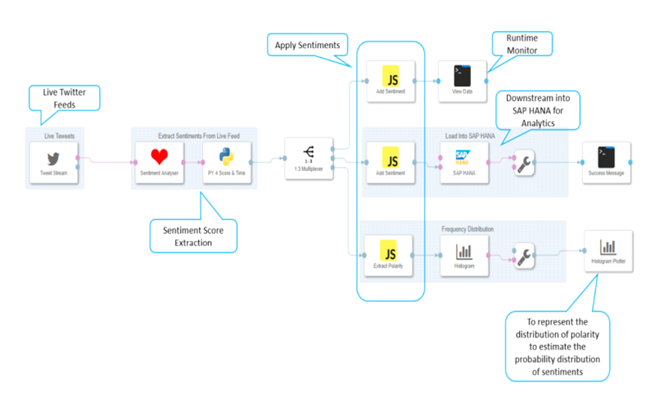

# Tweet Sentiment Analyzer

A Flask and MySQL web application that fetches tweets for a search query, classifies sentiment polarity (**positive**, **neutral**, **negative**) with TextBlob, flags profanity via `better-profanity`, and logs flagged accounts to MySQL.

---

## Architecture & Data Flow

<p align="center">
  
</p>

1. User submits a search topic and desired sample counts in `templates/FrontEnd.html`.
2. `BackEnd.py` calls `Analysis.TwitterClient` (`tweepy` + `TextBlob` + `better-profanity`).
3. Flagged tweets are persisted via `AbusiveTweetsDB.py` to `abusiveTweetsDB.abusiveTweetsTable`.
4. Sentiment distribution and filtered tweets render in `templates/DisplayResult.html`.

---

## Quick Start (Docker Compose)

1. Copy the environment template and add your Twitter Developer credentials:

```bash
cp .env.example .env
```

2. Build and start Flask + MySQL (auto-initializes `sql/schema.sql`):

```bash
docker compose up --build
```

3. Open **http://localhost:5000**.

---

## Running Locally (Without Docker)

1. Import `sql/schema.sql` into a local MySQL instance.
2. Install Python dependencies and TextBlob corpora:

```bash
pip install -r requirements.txt
python -m textblob.download_corpora
```

3. Configure `.env` (set `MYSQL_HOST=localhost`) and run:

```bash
python BackEnd.py
```

---

## Repository Structure

```text
├── BackEnd.py            # Flask routes and sentiment aggregation
├── Analysis.py           # TwitterClient, TextBlob polarity, profanity check
├── AbusiveTweetsDB.py    # MySQL persistence helper
├── sql/schema.sql        # Database and table DDL
├── templates/            # FrontEnd.html & DisplayResult.html
├── static/               # CSS, JS, fonts, and vendor assets
├── docs/                 # Data flow diagram
├── Dockerfile
├── docker-compose.yml
├── requirements.txt
└── .env.example
```
